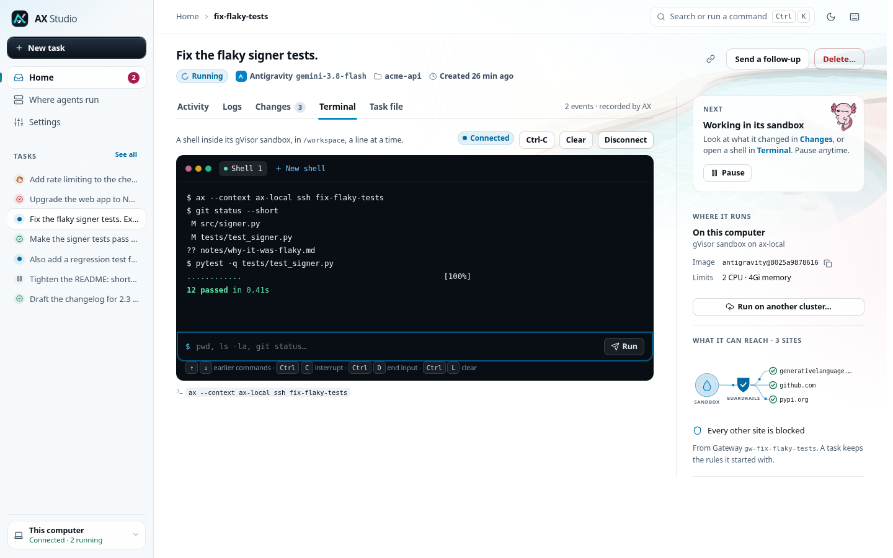
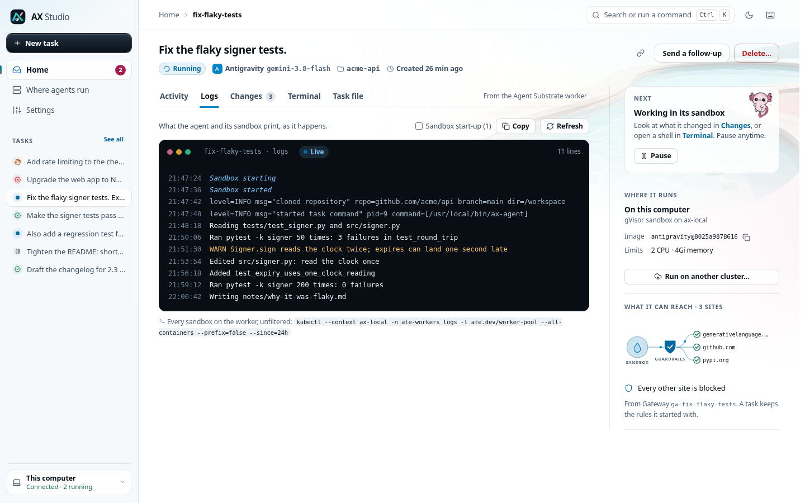

# AX Studio

A desktop app for [AX](https://github.com/google/ax): design tasks, watch them run, and create local
AX clusters. Runs on macOS, Windows and Linux.


- **Activity:** a sortable task table with running tasks on top, and the
  atespace's workspaces. Resume, suspend or delete tasks, inspect conditions,
  follow logs and delete workspaces.
- **Deploy:** build tasks with a form or raw YAML, then create them.
- **Terminal:** sessions into running tasks over `ax ssh`, in tabs that stay
  connected while you use the rest of the app.
- **Environments:** set up a local AX sandbox on kind, or connect to a team
  cluster and install AX on it.

| | |
|---|---|
|  **Deploy** |  **Terminal** |
|  **Clusters** |  **Task logs** |

The app calls the `ax` CLI and `kubectl`. It passes `--context` on every call,
so browsing and managing tasks never changes your global context. Creating or
starting a local cluster does: `ax local start` makes that cluster current.

The macOS and Linux installers include `ax`, and the app uses that copy unless
Settings names another. The release it comes from is pinned in
[fetch-ax.sh](scripts/fetch-ax.sh). AX has no Windows build, so on Windows the
app uses the `ax` on your PATH.

## Develop

```sh
npm install
npm run dev         # hot-reloading app
npm run typecheck
```

`npm run dev` uses the `ax` on your PATH or in `~/.ax/bin`; only packaged
builds carry their own. To develop against another `ax`, such as one you built
from source, set its full path in Settings (⌘,).

To refresh a screenshot, build (`npm run build`) and run:

```sh
npx electron . --section=clusters --delay=7000 --screenshot=docs/screenshots/clusters.png
```

Other flags: `--context`, `--atespace`, `--task`, `--logs=expanded`, `--terminal=<command>`.

## Package

```sh
scripts/fetch-ax.sh # the ax CLI to include
npm run dist:mac    # .dmg and .zip
npm run dist:win    # NSIS installer and .zip
npm run dist:linux  # AppImage, .deb, .tar.gz
```

Build each OS on that OS. macOS builds are unsigned; set `mac.identity` in
`electron-builder.yml` to sign. To regenerate the icon on macOS:

```sh
swift scripts/make-icon.swift ~/ax/assets/axel.svg build-resources/icon.icns
```

## Release

Push a version tag and [the Release workflow](.github/workflows/release.yml)
builds the app on macOS, Windows and Linux and publishes one GitHub release
with every installer and a `checksums.txt`:

```sh
git tag v0.0.1-test
git push origin v0.0.1-test
```

The app's version comes from the tag, not `package.json`. A tag with a `-`,
like the one above, is published as a prerelease. To try the build without
publishing, run the workflow by hand from the Actions tab; the installers are
kept as workflow artifacts.

The builds aren't signed yet. On macOS, clear the quarantine flag after
installing: `xattr -cr "/Applications/AX Studio.app"`. On Windows, SmartScreen
warns before the installer runs.

## Environments

The Environments page drives `ax`. It checks this machine, then offers two
places to run tasks:

- **Local Sandbox:** **Set Up Local Sandbox** runs `ax local start`, which
  creates or resumes a kind cluster named `ax-local`, installs Agent Substrate
  and AX, and downloads kind and kubectl into `~/.ax/bin` if you don't have
  them. It needs only a running rootful `docker` or `podman`. The sandbox
  becomes your current kubectl context. **Stop** and **Delete** run
  `ax local stop` and `ax local delete`.
- **Team clusters:** every other context in your kubeconfig. **Connect** points
  the app at one without changing your kubectl context. **Check** looks at a
  cluster with `kubectl`, read-only: whether it meets what Agent Substrate and
  AX need, and whether each is installed, with what to do next. **Install AX**
  runs `ax install` once Agent Substrate is there, and **Uninstall AX** runs
  `ax uninstall`, which keeps the database's volume; `ax` can't install Substrate
  on a remote cluster, so the page links to Substrate's guides for that. A
  fold-out lists what a new cluster needs.

`ax` has no default ax-server image yet, so the page asks for one before it
sets anything up. The app remembers the images you enter.

## Platform notes

- **macOS/Linux:** the app reads PATH from your login shell, and also looks in
  `~/.ax/bin` (or `$AX_HOME/bin`), where AX's installer puts `ax`.
- **Windows:** AX has no Windows build of `ax`, so the Environments page
  can't set up a sandbox there.
